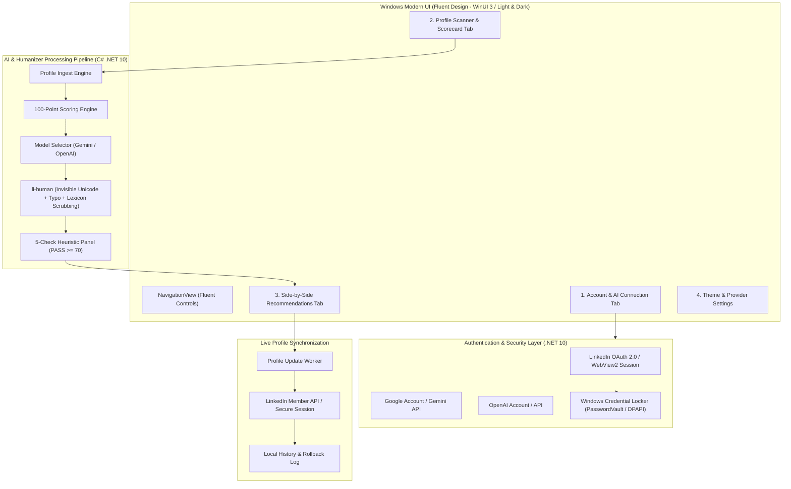

# Technical Specification: LI-pstick (Windows Modern UI)

**Application Name:** `LI-pstick` (Lip Stick for LinkedIn: makeup & polish for your profile)  
**Target Framework:** .NET 10 (C# 14 / Windows Modern UI - WinUI 3 / Windows App SDK)  
**Target Platform:** Windows 11 / Windows 10 (Modern Fluent Design System)  
**AI Providers Supported:** Google Gemini (Gemini 2.5 / 2.0 / 1.5 Series via Google.GenAI SDK) & OpenAI (GPT-4o, GPT-4o mini, o3-mini via OpenAI SDK)  
**Theme Support:** Windows Modern UI (Mica / Fluent), Light Theme (Default) & Dark Theme  
**Reference Engine:** [`Jakeschincariol/linkedin-agent-skill`](https://github.com/Jakeschincariol/linkedin-agent-skill)  

---

## 1. Product Vision & Architecture Overview

**LI-pstick** is a modern Windows desktop application built with .NET 10 (C#) and WinUI 3 / Windows App SDK that bridges professional LinkedIn optimization with multi-provider generative AI (Google Gemini & OpenAI). It allows users to authenticate their LinkedIn account, connect to AI models, scan their profile against an empirical 100-point rubric, review side-by-side humanized recommendations, and apply updates directly to their live LinkedIn profile with one click.

Just like lipstick adds polish and confidence, **LI-pstick** polishes and beautifies your professional presence on LinkedIn while stripping away machine fingerprints and AI slop.



---

## 2. Windows Modern UI Design System

### 2.1. Visual Design Principles
- **Design Language:** Microsoft Fluent Design System (Windows 11 / Windows App SDK).
- **Surface Materials:** Mica material (`MicaController` / `MicaBackdrop`) with Acrylic flyouts and modern rounded corners (8px–12px radius).
- **Typography:** Segoe UI Variable (`Display`, `Text`, and `Small`) for crisp font hierarchy.
- **Theme Support:**
  - **Light Theme (Default):** Clean white/off-white background (`#F9F9F9`), subtle neutral borders (`#E5E5E5`), LinkedIn brand accent (`#0A66C2`), and high-contrast text (`#1C1C1C`).
  - **Dark Theme:** Deep neutral slate background (`#202020`), elevated card surfaces (`#2C2C2C`), softened accent (`#70B5F9`), and bright text (`#FFFFFF`).
  - **System Theme Sync:** Option to follow Windows system color preference automatically.

### 2.2. Application Navigation & Layout Hierarchy
The application uses the Windows App SDK `NavigationView` with a left-aligned collapsible navigation bar and a multi-tab workspace:

1. **Connections & Setup (`/connect`)**: LinkedIn login status, Google/OpenAI sign-in cards, model picker.
2. **Profile Scanner (`/scan`)**: Live profile card, scan trigger, 100-point rubric breakdown.
3. **Recommendations & Diff (`/diff`)**: Side-by-side comparison tab with humanization metrics and before/after previews.
4. **Content Lab (`/content`)**: Companion tools from the 11 skills (Posts, Carousels, Weekly Plan, DM Outreach).
5. **History & Rollback (`/history`)**: Local change log tracking every applied profile edit with one-click restore.

---

## 3. Authentication & Provider Subsystems

### 3.1. LinkedIn Account Connection
- **Authentication Flow:**
  - Embedded Microsoft WebView2 control for interactive OAuth 2.0 handshake (`r_liteprofile`, `r_basicprofile`, `w_member_social`).
  - Secure persistent credential storage using the **Windows Credential Locker (`Windows.Security.Credentials.PasswordVault`) / DPAPI** to encrypt refresh tokens and session cookies.
  - Connection indicator badge in the title bar showing avatar, full name, profile headline, and connection health status (`Connected`, `Token Expiring`, `Disconnected`).
- **Profile Data Ingestion:**
  - Fetches: Headline, About summary, Experience entries (titles, companies, dates, descriptions), Featured assets, and Skills.

### 3.2. AI Provider Management (Google Gemini & OpenAI)
- **Multi-Provider Account Hub:**
  - **Google Connection:**
    - Sign in with Google (OAuth 2.0) or Gemini API key input.
    - Verified access to Google AI Studio / Gemini Developer APIs using official .NET SDK.
    - Supported Models: `Gemini 2.5 Flash / Pro`, `Gemini 2.0 Flash`, `Gemini 1.5 Pro`.
  - **OpenAI Connection:**
    - Sign in with OpenAI / API Key via official `OpenAI` .NET SDK.
    - Supported Models: `GPT-4o`, `GPT-4o mini`, `o3-mini`, `o1`.
  - **Model Selector UI:**
    - A modern Fluent `ComboBox` in the custom title bar allows the user to switch active models on the fly.
    - Displays provider badge, context window capacity, and estimated inference latency.

---

## 4. End-to-End Workflow Specification

### Step 1: Scan & Rubric Evaluation
1. User navigates to the **Profile Scanner** tab and clicks the primary **Scan Profile** button.
2. The engine fetches the user's current live profile data and evaluates it against the **12-part, 100-point rubric**:
   - *Headline* (12 pts)
   - *About: First 2 Lines* (10 pts)
   - *About: Body & Proof* (10 pts)
   - *Featured Items* (8 pts)
   - *Banner & Visual Positioning* (6 pts)
   - *Experience Outcomes & Metrics* (14 pts)
   - *Recommendations* (10 pts)
   - *Skills & Badges* (8 pts)
   - *Creator Mode Cadence* (8 pts)
   - *Education & Credentials* (6 pts)
   - *Custom URL & Contact Clarity* (4 pts)
   - *Headshot & Aesthetic Consistency* (4 pts)
3. The UI renders an interactive radial score gauge (e.g., `42 / 100 - Needs Attention`) and flags the highest-loss sections in fix-first priority order.

### Step 2: Generation & Heuristic Humanization
1. The engine constructs a structured generation prompt containing:
   - Current profile contents.
   - User voice constraints from `voice.md` (or dynamically inferred from recent posts).
   - Rubric target criteria.
2. The selected model (Gemini or OpenAI) generates candidate rewrites for Headline, About, and Experience bullets.
3. **Autonomous Humanization Pipeline (`li-human` in C#):**
   - **Pass 1 (Invisible Filter):** Deletes all zero-width characters (`U+200B`, `U+200D`, `U+2060`, `U+FEFF`, `U+00AD`, Unicode tag spaces).
   - **Pass 2 (Typography Normalization):** Converts em dashes (`—`) to commas, en dashes to hyphens, curly quotes to straight quotes, ellipses to three periods.
   - **Pass 3 (Lexical De-Slopping):** Scans against the extended `slop.json` dictionary (113+ stock words plus Gemini/OpenAI specific tells: *"delve"*, *"testament to"*, *"in the realm of"*, *"spearhead"*, *"seamless"*).
   - **Pass 4 (5-Check Heuristic Scoring):** Evaluates Burstiness, Specificity, Slop Density, Fingerprint, and Voice.
   - If the human score is $< 70$ or any single metric is $< 55$, the engine triggers an automated structural rewrite loop before presenting to the user.

### Step 3: Side-by-Side Recommendations Tab
The user is automatically transitioned to the **Recommendations** tab featuring a split-pane layout:

```text
+----------------------------------------------------------------------------------------------------+
|  [Tabs: Headline | About Section | Experience | Featured]              Model: [ Gemini 2.0 Flash v ]|
+--------------------------------------------------+-------------------------------------------------+
| CURRENT LIVE PROFILE                             | RECOMMENDED REWRITE (Human Score: 88 PASS)      |
+--------------------------------------------------+-------------------------------------------------+
| Senior Product Manager at Acme Corp              | Building AI agents that save B2B teams 10h/wk   |
| Helping businesses leverage AI solutions.        | | $4.2M pipeline generated | Ops @ Acme         |
|                                                  |                                                 |
| Points: 4 / 12                                   | Points: 11 / 12  (+7 pts)                       |
| Tells: Job title only, no proof, buzzwords       | Heuristics: 0 AI tells, 2 concrete numbers      |
+--------------------------------------------------+-------------------------------------------------+
| [ View Raw Diff ]                                | [ Edit Manually ]   [ Re-Generate ]  [ APPLY ]  |
+----------------------------------------------------------------------------------------------------+
```

- **Features in the Comparison View:**
  - **Side-by-Side Diffing:** Highlighting removed buzzwords in soft red and added concrete numbers/proof in soft green.
  - **Live Human Scorecard Pill:** Displays overall score (e.g., `88 PASS`) with a hover tooltip showing individual metrics (Burstiness: 78, Specificity: 92, Slop: 0, Fingerprint: 100, Voice: 82).
  - **Inline Text Editor:** Allows the user to tweak the draft directly; the humanizer score updates in real-time as the user types.

### Step 4: The "Apply" Action & Synchronization
1. When the user clicks the primary **Apply** button on an approved section (or **Apply All**):
   - A verification ContentDialog displays a summary of the pending modifications.
   - The engine validates that the humanizer score meets the minimum safety threshold ($\ge 70$).
2. The application executes the update via the authenticated LinkedIn connection.
3. The original text is saved to a local rollback log (`%LocalAppData%/LI-pstick/history.json`).
4. A Windows App SDK InAppNotification / Toast confirms: *"Headline successfully updated on LinkedIn. Previous version backed up to History."*

---

## 5. Technical Stack & Implementation Architecture

### 5.1. Desktop Framework
- **Framework:** **.NET 10 (C# 14)** with **WinUI 3 (Windows App SDK)** or **WPF Modern UI**.
- **UI Architecture:** MVVM (CommunityToolkit.Mvvm).
- **Styling:** Native Windows 11 Fluent Design System, Mica backdrop, Windows 11 native Light/Dark themes.
- **Embedded Browser:** Microsoft.Web.WebView2 for LinkedIn session handshake.
- **HTTP & Resilience:** `HttpClientFactory` with Polly for exponential backoff and rate-limit handling.
- **AI Integration:** Official .NET SDKs (`Google.GenAI` / `OpenAI`).

### 5.2. Local Storage & Security Specifications
- **Windows Credential Locker:** Tokens and keys stored securely using `Windows.Security.Credentials.PasswordVault` / DPAPI.
- **Application Data Directory:** `%LocalAppData%\LI-pstick\`
  - `voice.md` (Personal tone profile)
  - `plan.md` (Weekly content schedule)
  - `history.json` (Rollback snapshots of profile changes)
  - `config.json` (Application preferences & selected AI model)

---

## 6. Implementation Checklist

- [ ] **Phase 1: .NET 10 Modern UI Shell**
  - Setup .NET 10 solution (`LI-pstick.sln`) with WinUI 3 Modern Windows UI.
  - Configure Fluent Mica backdrop with Light (default) and Dark theme switching.
  - Implement collapsible `NavigationView` (`Connections`, `Scanner`, `Recommendations`, `History`).
- [ ] **Phase 2: Authentication Handlers**
  - Build LinkedIn OAuth 2.0 / WebView2 session manager with Windows Credential Locker encryption.
  - Implement Google Gemini API handler via Google SDK.
  - Implement OpenAI API handler via OpenAI .NET SDK.
  - Build Model Selector dropdown in the custom title bar.
- [ ] **Phase 3: Scanning & Analysis Engine**
  - Implement LinkedIn profile ingest worker.
  - Wire up the 100-point rubric evaluation engine in C# (`rubric.json`).
- [ ] **Phase 4: Side-by-Side Humanizer Pipeline (C# Native Engine)**
  - Port `humanize` logic to C# (invisible characters, typography, slop replacement).
  - Port `detect` logic to C# (burstiness, specificity, slop density, fingerprint, voice).
  - Build split-view comparison UI with live diff formatting and real-time scorecards.
- [ ] **Phase 5: Apply & Live Synchronization**
  - Implement LinkedIn profile update API calls.
  - Build history backup and rollback mechanism (`history.json`).
  - Add confirmation dialogs and safety threshold gates.
