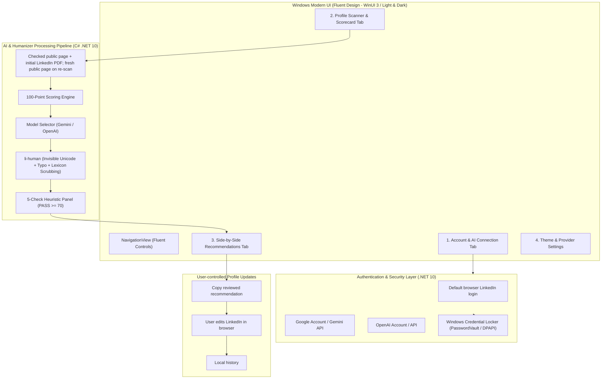

# Technical Specification: LIpstick (Windows Modern UI)

**Application Name:** `LIpstick` (Lipstick for LinkedIn: makeup & polish for your profile)  
**Application Icon:** `LIpstick-Logo.png`  
**Target Framework:** .NET 10 (C# 14 / Windows Modern UI - WinUI 3 / Windows App SDK)  
**Target Platform:** Windows 11 / Windows 10 (Modern Fluent Design System)  
**AI Providers Supported:** Google Gemini (Gemini 2.5 / 2.0 / 1.5 Series via Google.GenAI SDK) & OpenAI (GPT-4o, GPT-4o mini, o3-mini via OpenAI SDK)  
**Theme Support:** Windows Modern UI (Mica / Fluent), Light Theme (Default) & Dark Theme  
**Reference Engine:** [`Jakeschincariol/linkedin-agent-skill`](https://github.com/Jakeschincariol/linkedin-agent-skill)  

---

## 1. Product Vision & Architecture Overview

**LIpstick** is a modern Windows desktop application built with .NET 10 (C#) and WinUI 3 / Windows App SDK that helps people improve a LinkedIn profile using multi-provider generative AI (Google Gemini & OpenAI). Users enter a public profile URL, check whether LIpstick can read it, and import the PDF produced by LinkedIn's Save to PDF feature. The first scan combines the accessible public page and PDF to establish the profile and score baseline. After editing LinkedIn manually, Re-scan fetches the public page again and compares the updated profile with that baseline.

Just like lipstick adds polish and confidence, **LIpstick** polishes and beautifies your professional presence on LinkedIn while stripping away machine fingerprints and AI slop.



---

## 2. Windows Modern UI Design System

### 2.0. Approved Scanner Visual Reference
The Scanner tab must follow [`Scanner.png`](Scanner.png) for its visual hierarchy, spacing, pastel palette, and information arrangement. Use the LIpstick app icon only as the small brand mark in the navigation area; do not add decorative lipstick or mascot artwork to the Scanner page. Preserve the reference's compact navigation, restrained top bar, prominent scan action, single overall-score panel, and readable rubric list with only the highest-priority items marked “Fix first.” The image is a layout and styling reference only: use the exact category names and point weights defined in this specification and `data/rubric.json`; mockup scores and labels are not product data. Keep controls accessible and responsive at supported window sizes and display scaling.

### 2.0.1. Approved Improve Visual Reference
The Improve tab must follow [`Improve.png`](Improve.png) as its development template, using the same pastel palette, navigation, top bar, spacing, typography, and Fluent card styling as the Scanner reference. Provide selectable profile sections and show the selected section's current “As-Is” content beside an AI-generated, editable “To-Be” recommendation. Keep current content read-only, surface relevant issues, and display the humanizer verdict and its five metrics with actions to view the diff, edit, regenerate, or copy the selected section. LIpstick never writes profile changes to LinkedIn; the user applies edits manually and then re-scans. The image guides layout and styling only; sample text, scores, proof claims, and labels are illustrative and must not be treated as user data or fabricated into recommendations. Use the defined profile fields, provider contracts, and humanizer thresholds as the source of truth. Keep the screen accessible and responsive at supported window sizes and display scaling.

### 2.1. Visual Design Principles
- **Design Language:** Microsoft Fluent Design System (Windows 11 / Windows App SDK).
- **Surface Materials:** Mica material (`MicaController` / `MicaBackdrop`) with Acrylic flyouts and modern rounded corners (8px–12px radius).
- **Typography:** Segoe UI Variable (`Display`, `Text`, and `Small`) for crisp font hierarchy.
- **Theme Support:**
  - **Light Theme (Default):** Clean white/off-white background (`#F9F9F9`), subtle neutral borders (`#E5E5E5`), LinkedIn brand accent (`#0A66C2`), and high-contrast text (`#1C1C1C`).
  - **Dark Theme:** Deep neutral slate background (`#202020`), elevated card surfaces (`#2C2C2C`), softened accent (`#70B5F9`), and bright text (`#FFFFFF`).
  - **System Theme Sync:** Option to follow Windows system color preference automatically.

### 2.2. Application Navigation & Layout Hierarchy
The application uses the Windows App SDK `NavigationView` with a left-aligned collapsible navigation bar and a multi-tab workspace:

The sidebar includes the persistent LinkedIn, OpenAI, and Gemini login/status controls specified in 2.0.2, alongside the navigation destinations.

1. **Connections & Setup (`/connect`)**: LinkedIn login status, Google/OpenAI sign-in cards, model picker.
2. **Profile Scanner (`/scan`)**: Live profile card, scan trigger, 100-point rubric breakdown.
3. **Recommendations & Diff (`/diff`)**: Side-by-side comparison tab with humanization metrics and before/after previews.
4. **Content Lab (`/content`)**: Companion tools from the 11 skills (Posts, Carousels, Weekly Plan, DM Outreach).
5. **History & Rollback (`/history`)**: Local change log tracking every applied profile edit with one-click restore.

---

## 3. Authentication & Provider Subsystems

### 3.1. LinkedIn Profile Setup and Import
- **Login shortcut:** “Open LinkedIn Login” opens `https://www.linkedin.com/login` in the default browser. This does not connect LIpstick to the browser session. LIpstick never collects or stores LinkedIn passwords, cookies, or browser tokens.
- **Public URL and CHECK:** Connections shows a persisted member URL field (for example `https://www.linkedin.com/in/rsmaniam/`) with an adjacent **CHECK** action. CHECK validates the member URL and makes one unauthenticated request to confirm publicly readable content.
- **Save to PDF:** Connections explains LinkedIn desktop steps: **Me → View Profile → More or Resources → Save to PDF**. The user selects the downloaded PDF locally. LIpstick extracts its text and requires it for the initial scan.
- **Initial scan:** Fetch the checked public URL and combine its available content with the PDF. Preserve source provenance; prefer current public values for name/headline and use PDF details for sections the public page omits. Evaluate and save the initial profile and score as the baseline. Generate section recommendations when an AI provider is connected.
- **Re-scan:** After the user edits LinkedIn manually, fetch the public URL again. Evaluate only newly fetched public-page content, update the latest profile/score, retain the initial baseline, and show the score change. Never use the initial PDF as the re-scan result.
- **Failure behavior:** If a page cannot be read or a section is absent, show an actionable error or mark the field unavailable. Do not use stale content as fresh, bypass access controls, or invent profile data.
- **Privacy:** Store URL, imported PDF text, public page text, and profile snapshots locally. Disclose when selected profile content is sent to an AI provider, and remove it when local data is cleared.

### 3.2. AI Provider Management (Google Gemini & OpenAI)
- **Multi-Provider Account Hub:**
  - **Google Connection:**
    - Sign in with Google (OAuth 2.0) or Gemini API key input.
    - Verified access to Google AI Studio / Gemini Developer APIs using official .NET SDK.
    - Supported Models: `gemini-flash-latest` for validation/default, plus the configured Gemini Flash/Pro model options available to the account.
  - **OpenAI Connection:**
    - Sign in with OpenAI / API Key via official `OpenAI` .NET SDK.
    - Supported Models: `GPT-4o`, `GPT-4o mini`, `o3-mini`, `o1`.
  - **Model Selector UI:**
    - A modern Fluent `ComboBox` in the custom title bar allows the user to switch active models on the fly.
    - Displays provider badge, context window capacity, and estimated inference latency.

---

## 4. End-to-End Workflow Specification

### Step 1: Scan & Rubric Evaluation
1. User enters the public member profile URL in Connections and clicks adjacent **CHECK**. On LinkedIn desktop, use **Me → View Profile → More or Resources → Save to PDF**, then select that PDF in LIpstick.
2. The initial Scan fetches the checked public page and combines it with the PDF. LIpstick evaluates the combined profile against the **12-part, 100-point rubric** and saves its profile and score as the baseline:
   - *Headline* (12 pts)
   - *About: First 2 Lines* (10 pts)
   - *About: Body & Proof* (10 pts)
   - *Featured Items* (8 pts)
   - *Banner & Visual Positioning* (6 pts)
   - *Experience Outcomes & Metrics* (14 pts)
   - *Recommendations* (10 pts)
   - *Skills & Badges* (8 pts)
   - *Creator Mode Cadence* (8 pts)
   - *Education & Credentials* (6 pts)
   - *Custom URL & Contact Clarity* (4 pts)
   - *Headshot & Aesthetic Consistency* (4 pts)
3. Scanner shows the score and fix-first priorities. Improve generates section suggestions when an AI provider is connected.
4. The user applies changes manually in LinkedIn and clicks **Re-scan**. LIpstick fetches the public URL again, evaluates fresh public content only, retains the initial baseline, and reports the score delta. The initial PDF is not used as current scan data.

### Step 2: Generation & Heuristic Humanization
1. The engine constructs a structured generation prompt containing:
   - Current profile contents.
   - User voice constraints from `voice.md` (or dynamically inferred from recent posts).
   - Rubric target criteria.
2. The selected model (Gemini or OpenAI) generates candidate rewrites for Headline, About, and Experience bullets.
3. **Autonomous Humanization Pipeline (`li-human` in C#):**
   - **Pass 1 (Invisible Filter):** Deletes all zero-width characters (`U+200B`, `U+200D`, `U+2060`, `U+FEFF`, `U+00AD`, Unicode tag spaces).
   - **Pass 2 (Typography Normalization):** Converts em dashes (`—`) to commas, en dashes to hyphens, curly quotes to straight quotes, ellipses to three periods.
   - **Pass 3 (Lexical De-Slopping):** Scans against the extended `slop.json` dictionary (113+ stock words plus Gemini/OpenAI specific tells: *"delve"*, *"testament to"*, *"in the realm of"*, *"spearhead"*, *"seamless"*).
   - **Pass 4 (5-Check Heuristic Scoring):** Evaluates Burstiness, Specificity, Slop Density, Fingerprint, and Voice.
   - If the human score is $< 70$ or any single metric is $< 55$, the engine triggers an automated structural rewrite loop before presenting to the user.

### Step 3: Side-by-Side Recommendations Tab
The user is automatically transitioned to the **Recommendations** tab featuring a split-pane layout:

```text
+----------------------------------------------------------------------------------------------------+
|  [Tabs: Headline | About Section | Experience | Featured]              Model: [ Gemini 2.0 Flash v ]|
+--------------------------------------------------+-------------------------------------------------+
| CURRENT LIVE PROFILE                             | RECOMMENDED REWRITE (Human Score: 88 PASS)      |
+--------------------------------------------------+-------------------------------------------------+
| Senior Product Manager at Acme Corp              | Building AI agents that save B2B teams 10h/wk   |
| Helping businesses leverage AI solutions.        | | $4.2M pipeline generated | Ops @ Acme         |
|                                                  |                                                 |
| Points: 4 / 12                                   | Points: 11 / 12  (+7 pts)                       |
| Tells: Job title only, no proof, buzzwords       | Heuristics: 0 AI tells, 2 concrete numbers      |
+--------------------------------------------------+-------------------------------------------------+
| [ View Raw Diff ]                                | [ Edit Manually ]   [ Re-Generate ]  [ COPY ]   |
+----------------------------------------------------------------------------------------------------+
```

- **Features in the Comparison View:**
  - **Side-by-Side Diffing:** Highlighting removed buzzwords in soft red and added concrete numbers/proof in soft green.
  - **Live Human Scorecard Pill:** Displays overall score (e.g., `88 PASS`) with a hover tooltip showing individual metrics (Burstiness: 78, Specificity: 92, Slop: 0, Fingerprint: 100, Voice: 82).
  - **Inline Text Editor:** Allows the user to tweak the draft directly; the humanizer score updates in real-time as the user types.

### Step 4: Manual LinkedIn Update
1. The user reviews and edits the recommendation. LIpstick enforces the humanizer review gate before presenting it as ready.
2. The user copies the approved text and makes the change directly in LinkedIn using their browser.
3. LIpstick never claims that a LinkedIn update succeeded and does not perform profile writes or rollback through LinkedIn.
4. The user returns to Scanner and selects **Re-scan**. LIpstick fetches the public URL again to refresh current profile content and compare with the initial baseline.

---

## 5. Technical Stack & Implementation Architecture

### 5.1. Desktop Framework
- **Framework:** **.NET 10 (C# 14)** with **WinUI 3 (Windows App SDK)** or **WPF Modern UI**.
- **Application Icon:** `LIpstick-Logo.png`
- **UI Architecture:** MVVM (CommunityToolkit.Mvvm).
- **Styling:** Native Windows 11 Fluent Design System, Mica backdrop, Windows 11 native Light/Dark themes.
- **LinkedIn access:** Browser login shortcut, checked public profile URL, initial LinkedIn Save to PDF import, and fresh public URL fetch on each re-scan. No browser-session extraction or profile write-back.
- **HTTP & Resilience:** `HttpClientFactory` with Polly for exponential backoff and rate-limit handling.
- **AI Integration:** Official .NET SDKs (`Google.GenAI` / `OpenAI`).

### 5.2. Local Storage & Security Specifications
- **Windows Credential Locker:** Tokens and keys stored securely using `Windows.Security.Credentials.PasswordVault` / DPAPI.
- **Application Data Directory:** `%LocalAppData%\LIpstick\`
  - `voice.md` (Personal tone profile)
  - `plan.md` (Weekly content schedule)
  - `history.json` (Rollback snapshots of profile changes)
  - `config.json` (Application preferences & selected AI model)

---

## 6. Milestone Test and Acceptance Policy

The functional cases in [`TEST-PLAN.md`](TEST-PLAN.md) are mandatory gates after each major implementation milestone. Tests must use deterministic fakes for LinkedIn, Gemini, OpenAI, WebView2, notifications, and filesystem unless a case explicitly requires a separately approved sandbox account. Do not advance to the next milestone while a required case is failing or has no recorded evidence.

### 6.1 Required cadence

1. **After Phase 1 (shell):** Run T1, T2, T4 and SH-01 through SH-05. Confirm all routes, themes, keyboard navigation, DPI, resize, and accessibility basics.
2. **After Phase 2 (LinkedIn setup and providers):** Run T1-T4, LI-01 through LI-07, AI-01 through AI-05, and ST-01. Confirm URL CHECK, PDF selection, baseline scan, re-scan, provider contracts, cancellation, and redaction.
3. **After Phase 3 (scanner and rubric):** Run T1-T4, SC-01 through SC-05, plus the Phase 2 regression set. Confirm exact 100-point weighting, deterministic priorities, partial/offline behavior, and no write-back.
4. **After Phase 4 (humanizer and recommendations):** Run T1-T5, HU-01 through HU-06, DF-01 through DF-05, plus scanner/provider regressions. Confirm every cleaning rule, threshold boundary, diff, live score, and edit-preservation behavior.
5. **After Phase 5 (apply and history):** Run T1-T6, AP-01 through AP-06, plus the complete prior regression set. Confirm score gates, confirmation, atomic backup, partial failure handling, and rollback.
6. **After Phase 6 (Content Lab):** Run T1-T6, CL-01 through CL-06, plus humanizer/storage regressions. Confirm all 11 skills, no fabrication, output constraints, persistence, and explicit external-action gates.
7. **Release candidate:** Run RE-01 through RE-06, all milestone regression cases, secret scanning, packaging, accessibility, resilience, and the full end-to-end workflow.

### 6.2 Evidence and exit criteria

For every case record the commit/build, OS version, fixture or fake version, timestamp, result, and evidence link or screenshot. A milestone is accepted only when its required cases pass, T1-T6 are satisfied where applicable, defects are triaged, and the acceptance record is attached to the corresponding GitHub issue. A failed, cancelled, interrupted, or malformed operation must preserve the last valid data and must not cause an unintended LinkedIn write.

## 7. Implementation Checklist

- [ ] **Phase 1: .NET 10 Modern UI Shell**
  - Setup .NET 10 solution (`LIpstick.sln`) with WinUI 3 Modern Windows UI.
  - Configure application icon to use `LIpstick-Logo.png`.
  - Configure Fluent Mica backdrop with Light (default) and Dark theme switching.
  - Implement collapsible `NavigationView` (`Connections`, `Scanner`, `Recommendations`, `History`).
- [ ] **Phase 2: LinkedIn Setup and AI Providers**
  - Open LinkedIn in the default browser as a convenience; persist a public profile URL with adjacent CHECK; explain and import Save to PDF for the initial scan. Never store LinkedIn passwords or read browser sessions.
  - Implement Google Gemini API handler via Google SDK.
  - Implement OpenAI API handler via OpenAI .NET SDK.
  - Build Model Selector dropdown in the custom title bar.
- [ ] **Phase 3: Scanning & Analysis Engine**
  - Implement LinkedIn profile ingest worker.
  - Wire up the 100-point rubric evaluation engine in C# (`rubric.json`).
- [ ] **Phase 4: Side-by-Side Humanizer Pipeline (C# Native Engine)**
  - Port `humanize` logic to C# (invisible characters, typography, slop replacement).
  - Port `detect` logic to C# (burstiness, specificity, slop density, fingerprint, voice).
  - Build split-view comparison UI with live diff formatting and real-time scorecards.
- [ ] **Phase 5: Apply & Live Synchronization**
  - Provide reviewed recommendations for user-controlled manual edits; no unsupported LinkedIn profile writes.
  - Keep initial and latest local scan snapshots and scores; first scan combines PDF + public page, later re-scans refresh from public page only.
  - Add confirmation dialogs and safety threshold gates to recommendation review.

### 2.0.2. Sidebar Account Login and Status
The left navigation sidebar must include persistent account controls for LinkedIn, OpenAI, and Gemini. The LinkedIn action opens the login page in the default browser. Show profile setup state based on whether a valid public profile URL is saved; do not imply that LIpstick can verify browser sign-in. The browser manages and may remember LinkedIn credentials; LIpstick must never request or store them. These controls appear consistently on Scanner and Improve and remain accessible when the sidebar is collapsed.

LinkedIn profile setup is independent from AI-provider status. Connections checks the saved public profile URL and imports the user's LinkedIn PDF. The first scan combines both sources; each later re-scan fetches the public page again without browser cookies and compares with the initial baseline. A failed fetch is reported and does not silently reuse stale data. Profile edits are manual in LinkedIn. The model dropdown lists models only from connected AI providers; if neither OpenAI nor Gemini is connected, show an empty disabled selector with a prompt to connect at least one provider. Provider credentials are protected and never stored in ordinary preferences.

### 2.0.3. Approved Supporting Screen Wireframes
Use [`Connections-Content-History-Settings.png`](Connections-Content-History-Settings.png) as the visual reference for Connections, Content Lab, History, and Settings. Keep the established pastel palette, persistent account statuses, compact navigation, clear hierarchy, and generous spacing from Scanner and Improve. Connections shows separate provider cards and the requirement to connect at least one AI provider for model choices. Content Lab presents skill selection, drafting controls, and a visible notice that content is not sent or published automatically. History provides filters, change summaries, scores/status, and confirmed restore. Settings groups appearance, AI defaults, local data/privacy, export, and confirmed deletion. Treat example identities, content, values, and records as illustrative; runtime state and this specification govern actual behavior. Maintain responsive layouts and accessible control labels/statuses.

### Implementation checkpoint — 2026-11-21
- Content Lab now routes all 11 skill selections through their matching service operation, with per-skill inputs, draft retention while switching tools, and a visible result/status area. Outputs are local drafts; the app does not publish or send them.
- Content Lab generation remains under implementation review. Verify each workflow against its skill contract, especially fabricated-data safeguards and generated-output quality, before closing Phase 6.
- LinkedIn's ordinary-user flow uses a public URL with adjacent CHECK, a user-selected Save to PDF for the initial scan, and a fresh unauthenticated public-page fetch for each re-scan. No developer app, browser-session access, or profile write API is required. Provider live validation still needs user credentials.
- UI wireframe fidelity gaps are tracked in GitHub issues #12–#14 and remain backlog work.
